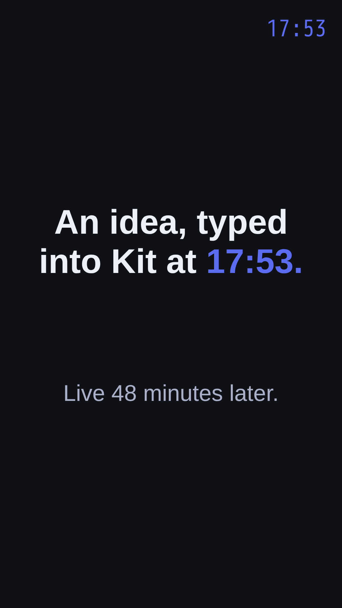
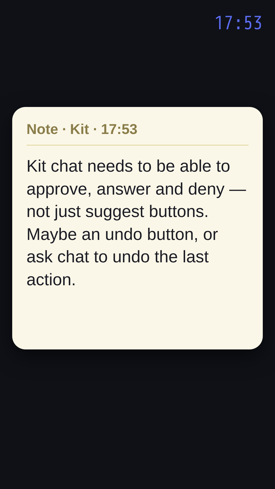
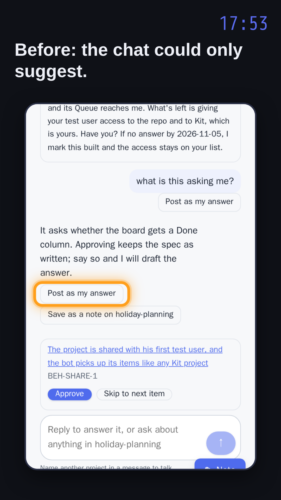
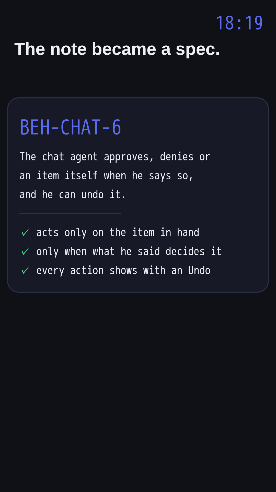
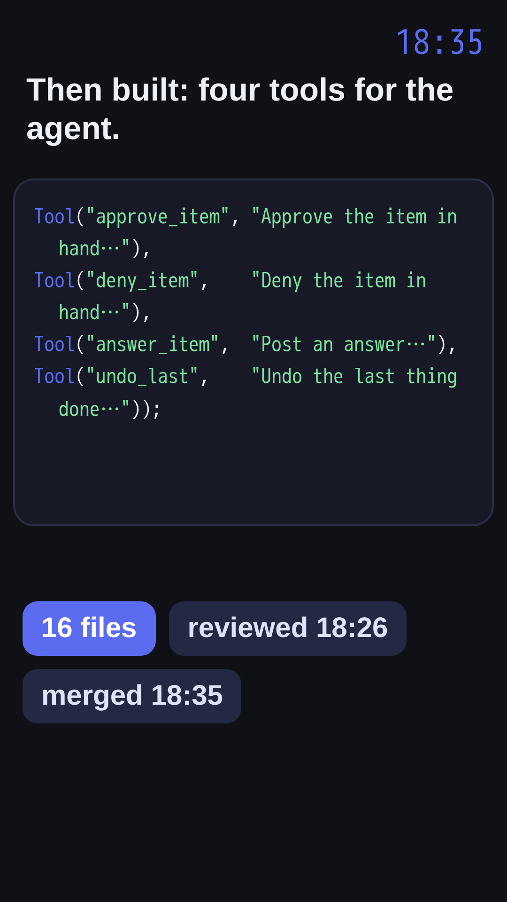
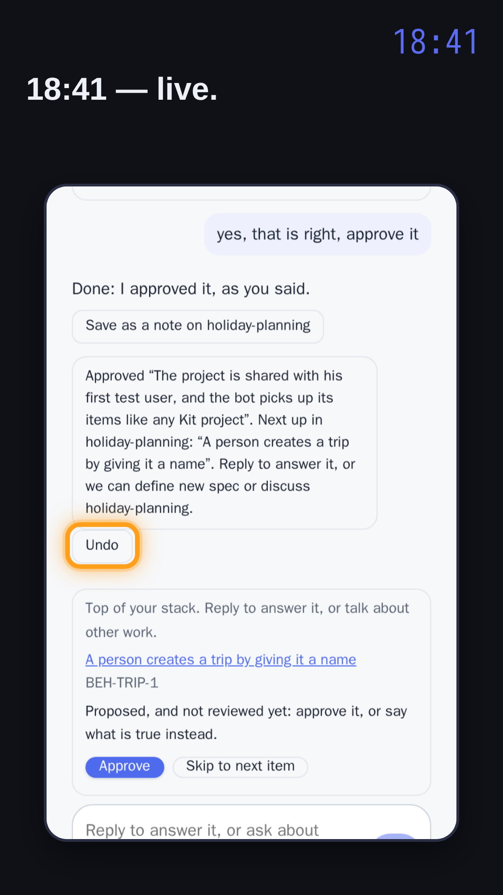
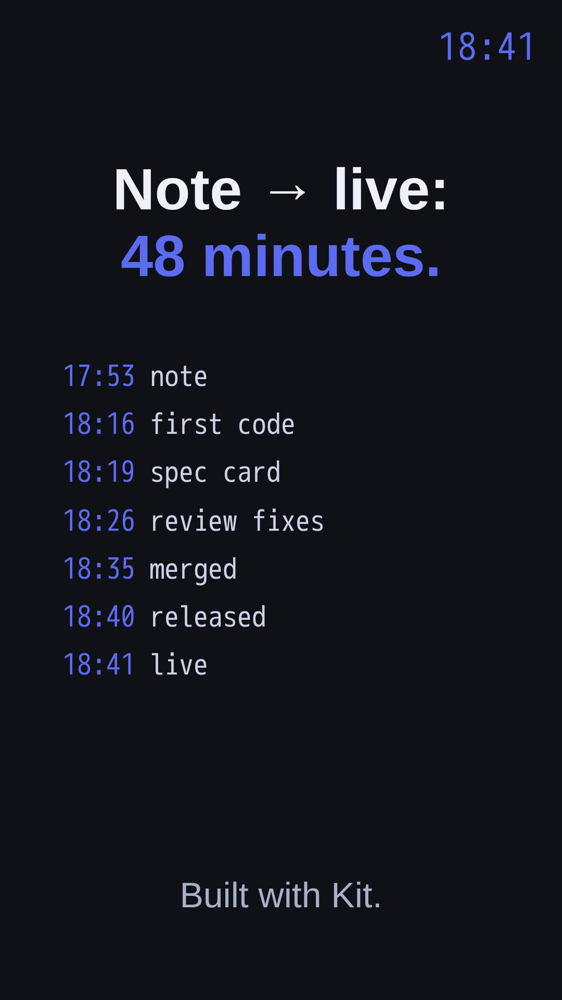

# Build-channel draft 1: "48 minutes" (snip-it BEH-BUILD-1, candidate 2)

A private draft for you to watch. **Do not merge.** This branch is deleted once you've seen it, and
nothing here is public. Vertical 9:16, about 42 seconds, with no voice and no music.

Every time shown comes from git: note 17:53 · spec card 18:19 · review fixes 18:26 · merged 18:35 ·
released 18:40 · live 18:41 (2026-11-02, kit#633).

| # | Time on screen | What you see |
|---|---|---|
| 1 | 0–3s | "An idea, typed into Kit at 17:53." / "Live 48 minutes later." |
| 2 | 3–12s | Your note types itself out (lightly edited for typos) |
| 3 | 12–17s | Before: the chat could only suggest ("Post as my answer") |
| 4 | 17–24s | The note became a spec: BEH-CHAT-6 and its three assumptions |
| 5 | 24–32s | Then built: the agent's four tools; reviewed 18:26, merged 18:35 |
| 6 | 32–39s | 18:41, live: "approve it" → "Done" → Undo |
| 7 | 39–42s | "Note → live: 48 minutes." / "Built with Kit." |

## Draft description (for when it is posted, by you)

> A note I left in Kit at 17:53 was live at 18:41. Kit is the tool I'm building to turn notes into
> specs and specs into features. Messages are lightly edited for length and typos; the times are real.

## Why there is no video file yet

The animation is a web page that the pod can step through frame by frame. Recording it needs an ffmpeg
build that this pod doesn't have, and the build it does have can't be run without an approval. Where
the rendered video should live (BEH-BUILD-2's drafts volume on snip-it) is also still a chart change
waiting for you. Until then the draft is these stills, as BEH-BUILD-1 says.
